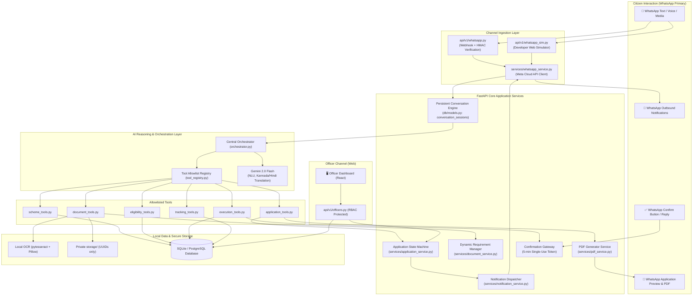
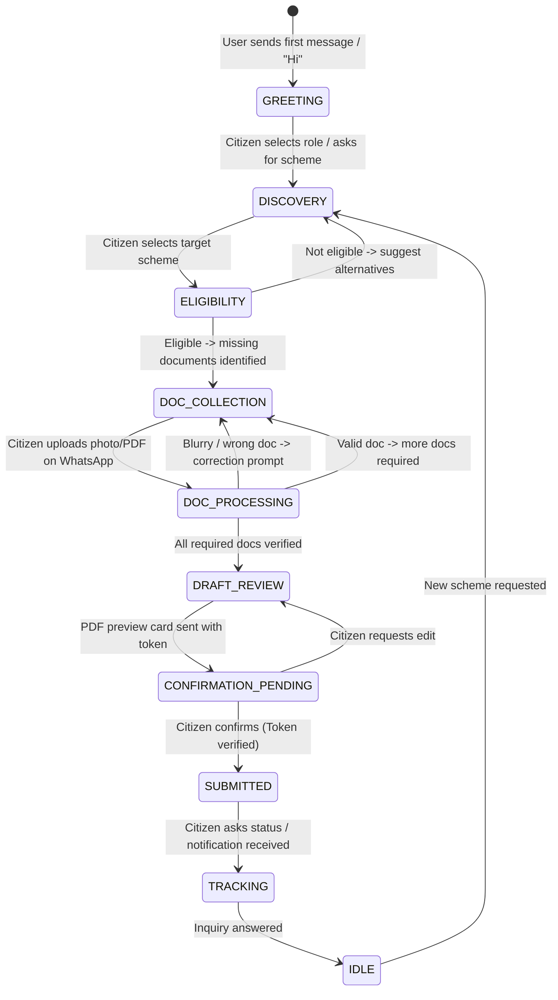

# Gram Saathi — System Architecture

> **Implementation-Ready Architecture Document — WhatsApp-First Edition**
> Version: 2.0 | Scope: MVP (18h build target) | Primary Channel: WhatsApp

---

## 1. System Overview

**Gram Saathi** ("Village Companion") is an AI-powered rural government service execution platform. Unlike an ordinary conversational AI chatbot, Gram Saathi is a complete **end-to-end service execution platform** that uses WhatsApp as its primary citizen interface, backed by a robust FastAPI service layer, persistent state machines, and an authorised officer portal.

It bridges the rural digital divide by meeting citizens on WhatsApp in their native languages (**Kannada** and **Hindi**) to discover schemes, evaluate eligibility, dynamically request and validate documents, compile official applications into printable PDFs, obtain explicit citizen consent, execute submissions, and provide real-time tracking with proactive notifications.

### Platform Capabilities (10 Core Pillars)

| # | Capability | Description | Primary Engine |
|---|---|---|---|
| 1 | **Scheme Discovery & Recommendation** | Intent parsing, semantic search, and personalized scheme recommendations across 6 rural citizen groups. | Scheme Tools + Gemini Reasoning |
| 2 | **Eligibility Assessment** | Deterministic criteria evaluation against citizen demographic & socio-economic profile. | Eligibility Engine (DB rules, not AI guesses) |
| 3 | **Dynamic Document Requests** | Sequentially prompt citizen on WhatsApp for exactly the documents required by the target scheme. | Dynamic Document Engine |
| 4 | **WhatsApp Image & PDF Uploads** | Receive document photos and PDF files via Meta WhatsApp Cloud API / local simulator. | WhatsApp Service + Storage Service |
| 5 | **OCR & Document Validation** | Local OCR extraction, data validation, readability verification, and automated correction requests. | OCR Service (pytesseract + Pillow) |
| 6 | **Application Preparation & PDF Generation** | Assemble verified fields into official schema and generate downloadable, printable summary PDF. | Application Service + PDF Service |
| 7 | **Citizen Review & Confirmation** | Deliver application preview card; mandate explicit consent via 5-min single-use confirmation token. | Confirmation Protocol (Security Gateway) |
| 8 | **Authorised & Assisted Submission** | Direct simulated portal filing or routing to Panchayat/Tehsil staff for assisted official submission. | ServiceExecutor + Officer Queue |
| 9 | **Officer Review & Decision** | Role-protected web dashboard for Panchayat/Tehsil staff to inspect, verify, and formally approve/reject. | Officer Dashboard (React + FastAPI) |
| 10 | **Application Tracking & Notifications** | Multi-channel status inquiry and automated proactive multilingual WhatsApp template notifications. | Notification Engine + WhatsApp API |

---

## 2. Channel Architecture & Core Principles

```
  ┌────────────────────────────────────────────────────────────────────────┐
  │                    CITIZEN CHANNELS                                    │
  │  ┌─────────────────────────────────┐   ┌────────────────────────────┐  │
  │  │  📱 WhatsApp (Primary Channel)   │   │  🌐 Mobile PWA (Secondary) │  │
  │  │  Meta WhatsApp Cloud API / Sim  │   │  React 18 + Tailwind CSS   │  │
  │  └────────────────┬────────────────┘   └─────────────┬──────────────┘  │
  └───────────────────┼──────────────────────────────────┼─────────────────┘
                      │ Webhook POST                     │ REST / JSON
                      ▼                                  ▼
  ┌────────────────────────────────────────────────────────────────────────┐
  │                     FASTAPI CENTRAL APPLICATION BACKEND                │
  │  ┌──────────────────────────────────────────────────────────────────┐  │
  │  │ API Router (/api/v1/whatsapp, /citizens, /schemes, /applications)│  │
  │  └────────┬───────────────────────────┬─────────────────────────────┘  │
  │           │                           │                                │
  │           ▼                           ▼                                │
  │  ┌──────────────────────┐   ┌───────────────────────────────────────┐  │
  │  │ Persistent           │   │ Central AI Orchestrator (Gemini)      │  │
  │  │ Conversation Engine  │◄─►│ - Reasoning & Dialogue (Kannada/Hindi)│  │
  │  │ - Multi-day state    │   │ - Intent & Slot Extraction            │  │
  │  │ - Session resumption │   │ - Controlled Allowlisted Tools Only   │  │
  │  └────────┬─────────────┘   └───────────────────┬───────────────────┘  │
  │           │                                     │                      │
  │           ▼                                     ▼                      │
  │  ┌──────────────────────────────────────────────────────────────────┐  │
  │  │ Deterministic Business Logic & Execution Engines (NOT Gemini)   │  │
  │  │ - Application State Machine (DRAFT -> SUBMITTED -> APPROVED)     │  │
  │  │ - Deterministic Eligibility Scorer                               │  │
  │  │ - Dynamic Document Requirement & Validation Manager              │  │
  │  │ - PDF Generator (ReportLab / WeasyPrint)                         │  │
  │  │ - Citizen Confirmation Token Validator (5-min single-use)       │  │
  │  └────────┬─────────────────────────────────────┬───────────────────┘  │
  │           │                                     │                      │
  │           ▼                                     ▼                      │
  │  ┌──────────────────────┐   ┌───────────────────────────────────────┐  │
  │  │ Local OCR Engine     │   │ Private Document Storage (storage/)   │  │
  │  │ (pytesseract+Pillow) │   │ - UUID filenames, no public URLs      │  │
  │  └──────────────────────┘   └───────────────────────────────────────┘  │
  └───────────────────┬──────────────────────────────────┬─────────────────┘
                      │ SQL (SQLAlchemy Async)           │ REST / JWT Auth
                      ▼                                  ▼
  ┌───────────────────────────────────┐    ┌───────────────────────────────┐
  │ SQLite Database (aiosqlite)       │    │ 🖥️ Officer Web Dashboard       │
  │ (PostgreSQL-ready schema)         │    │ (Panchayat & Tehsil Staff)    │
  └───────────────────────────────────┘    └───────────────────────────────┘
```

### Key Architectural Tenets

1. **WhatsApp-First by Design**:
   - The primary citizen lifecycle happens inside WhatsApp: text, interactive button replies, list messages, document photos, and PDF downloads.
   - When Meta API credentials (`WHATSAPP_TOKEN`) are absent during development, the backend automatically switches to the built-in **WhatsApp Simulator** UI without changing any backend business logic.
2. **FastAPI is the Single Source of Truth**:
   - WhatsApp webhooks, the mobile PWA, and the officer dashboard all invoke the exact same core business logic, services, and database models.
3. **Gemini is the Reasoning Layer, NOT the Authority**:
   - **Gemini handles**: Natural language understanding, conversational dialogue in Kannada and Hindi, explaining complex scheme benefits empathetically, and parsing slots from citizen text.
   - **Gemini DOES NOT**: Query raw SQL, decide scheme eligibility, validate confirmation tokens, transition application states, or execute submissions. All business decisions are enforced deterministically by FastAPI code.
4. **Persistent Multi-Day Conversation Management**:
   - Rural citizens often start an interaction, get interrupted, find their documents two days later, and return. The conversation state machine is stored in the database (`conversation_sessions`) and automatically resumes right where the user left off.
5. **Private, Opaque Document Storage**:
   - Documents are stored in `storage/` with UUID names (original filenames discarded). Files are never served statically. Access requires authenticated streaming or time-limited tokens.
6. **Strict Citizen Confirmation & Authorised Staff Decisions**:
   - No application is ever submitted without a validated, single-use, 5-minute confirmation token generated after previewing the compiled application.
   - Official decisions (Approval/Rejection) are exclusively reserved for authenticated Panchayat or Tehsil officers.

---

## 3. High-Level Component Flow



---

## 4. The 6 Capability Groups & Tool Architecture

The central AI orchestrator coordinates six capability groups through explicit, allowlisted Python functions. Each tool is strictly typed, handles errors safely, and logs calls without PII.

```
┌──────────────────────────────────────────────────────────────────────────────────┐
│                             CENTRAL AI ORCHESTRATOR                              │
├────────────────────┬───────────────────────────────────┬─────────────────────────┤
│ Capability Group   │ Primary Responsibilities          │ Allowlisted Tool Names  │
├────────────────────┼───────────────────────────────────┼─────────────────────────┤
│ 1. SchemeDiscovery │ - Search schemes by query/category│ search_schemes          │
│                    │ - Filter by target citizen group  │ list_scheme_categories  │
│                    │ - Fetch scheme details (kn/hi)    │ get_scheme_details      │
├────────────────────┼───────────────────────────────────┼─────────────────────────┤
│ 2. Eligibility     │ - Evaluate criteria determinist-  │ assess_eligibility      │
│    Assessor        │   ically against profile fields   │ get_eligibility_criteria│
│                    │ - Calculate match score & gaps    │                         │
├────────────────────┼───────────────────────────────────┼─────────────────────────┤
│ 3. Document        │ - Identify scheme document rules  │ get_required_documents  │
│    Intelligence    │ - Ingest WhatsApp media & run OCR │ process_document_upload │
│                    │ - Validate fields & trigger       │ validate_document_ocr   │
│                    │   correction requests             │ request_doc_correction  │
├────────────────────┼───────────────────────────────────┼─────────────────────────┤
│ 4. Application     │ - Compile answers + OCR data      │ draft_application       │
│    Preparator      │ - Generate printable summary PDF  │ generate_app_pdf        │
│                    │ - Formulate preview & consent card│ preview_application     │
├────────────────────┼───────────────────────────────────┼─────────────────────────┤
│ 5. Service         │ - Validate 5-minute single-use    │ submit_application      │
│    Executor        │   confirmation token              │ assign_to_officer       │
│                    │ - Execute simulated portal submit │ get_submission_status   │
│                    │   or route to assisted officer    │                         │
├────────────────────┼───────────────────────────────────┼─────────────────────────┤
│ 6. Application     │ - Query status across lifecycle   │ get_application_status  │
│    Tracker         │ - Fetch status timeline history   │ list_citizen_apps       │
│                    │ - Dispatch WhatsApp notifications │ notify_citizen_status   │
└────────────────────┴───────────────────────────────────┴─────────────────────────┘
```

---

## 5. Persistent Conversation Engine

A core requirement of Gram Saathi is that **conversation state must survive server restarts and users returning after days**.

### Conversation State Machine



### Returning Citizen Handling (Multi-Day Persistence)
1. Every WhatsApp message includes the citizen's phone number (`From: 919876543210`).
2. The backend looks up `conversation_sessions` by `phone_number`.
3. If a session exists and was active within the past 30 days:
   - System loads `conversation_stage`, `active_scheme_id`, `active_application_id`, and `context_data`.
   - If user is in `DOC_COLLECTION` and sends an image, the system immediately routes it to the expected document upload pipeline.
   - If user sends a greeting after 3 days ("Hello"), the system replies: *"Welcome back, Ramu! We were preparing your PM-KISAN application. You still need to provide your Land Record. Would you like to upload it now?"* (in Kannada/Hindi).
4. No in-memory dictionaries or volatile session stores are used for conversation state.

---

## 6. Dynamic Document Lifecycle & Private Storage

```
  Meta WhatsApp Cloud API / Simulator
               │
               ▼  (Receives image/jpeg or application/pdf)
  api/v1/whatsapp.py Webhook
               │
               ▼  (Downloads media bytes using Meta access token)
  services/storage_service.py
  - Generates opaque UUID (e.g., 9b1deb4d-3b7d-4bad-9bdd-2b0d7b3dcb6d.pdf)
  - Computes SHA-256 integrity hash
  - Saves file to private local `storage/` directory (gitignored, 0700 permissions)
  - NEVER creates public URL or serves statically
               │
               ▼
  services/ocr_service.py (Local Execution Only)
  - Pre-processes image (deskew, contrast enhancement via Pillow)
  - Runs pytesseract (eng + kan + hin)
  - Extracts structured fields (Name, Masked Aadhaar last 4, Land Area)
  - Raw image bytes NEVER sent to Gemini API
               │
               ▼
  services/document_validation_service.py
  - Compares extracted fields against scheme requirements & citizen profile
  - Checks readability confidence score
  - OutCome A: VALID -> Marks requirement satisfied -> Advances state
  - OutCome B: NEEDS_CORRECTION -> Proactively sends WhatsApp message:
    "ಚಿತ್ರವು ಸ್ಪಷ್ಟವಾಗಿಲ್ಲ. ದಯವಿಟ್ಟು ಬೆಳಕಿನಲ್ಲಿ ಸ್ಪಷ್ಟವಾದ ಫೋಟೋ ಕಳುಹಿಸಿ." (Kannada)
    ("Photo is blurry. Please send a clear photo in good lighting.")
```

---

## 7. Application Preparation & PDF Generation

Before submission, Gram Saathi compiles all data into an official-standard application:
1. **Application Compilation**: Combines citizen profile inputs, scheme code, and verified OCR document data into a structured JSON schema.
2. **PDF Generation Service (`services/pdf_service.py`)**:
   - Renders a formal 1-page or 2-page summary document with government-style layout (National/State scheme emblem header, applicant demographic details, attached document checklist with hashes, and declaration statement).
   - Generates the PDF securely in private `storage/` with UUID filename.
3. **WhatsApp Preview Delivery**:
   - Sends the citizen a high-level summary card via WhatsApp text.
   - Provides a short-lived, signed download link (TTL: 10 minutes) or delivers the PDF directly as a WhatsApp media document message.
4. **Citizen Consent Protocol**:
   - Issues a cryptographically random, single-use confirmation token (`secrets.token_urlsafe(32)`) valid for **5 minutes**.
   - Requires the citizen to click a WhatsApp interactive button `[Confirm Submission]` or reply with `CONFIRM <token>`.

---

## 8. Authorised Submission vs Assisted Official Submission

The platform supports two realistic service execution paths:

```
                      CITIZEN CONFIRMS APPLICATION
                                    │
                                    ▼
                     Application State: SUBMITTED
                                    │
           ┌────────────────────────┴────────────────────────┐
           ▼                                                 ▼
   DIRECT CITIZEN FILING                           ASSISTED OFFICIAL FILING
   (Schemes allowing self-service)                 (Schemes requiring official sign-off)
           │                                                 │
           ▼                                                 ▼
   ServiceExecutor runs portal                       Assigned to local Panchayat /
   submission stub [SIMULATED]                       Tehsil Staff via jurisdiction
           │                                                 │
           ▼                                                 ▼
   Generates SIM-YYYY-XXXX ref                       Enters Officer Review Queue
           │                                                 │
           ▼                                                 ▼
   WhatsApp Notification sent                        Officer inspects on Web Dashboard
   to citizen with reference                         Officer approves / rejects
                                                             │
                                                             ▼
                                                     Official decision recorded;
                                                     proactive WhatsApp notification sent
```

---

## 9. Officer Web Dashboard Architecture

The Officer Dashboard is a dedicated web interface built with **React 18, TypeScript, and Tailwind CSS**, communicating with FastAPI via role-protected endpoints:

- **Authentication**: JWT token with embedded RBAC role (`PANCHAYAT_STAFF`, `TEHSIL_STAFF`, `ADMIN`).
- **Jurisdiction Enforcement**: Backend checks `officer.jurisdiction_district` and `officer.jurisdiction_village`. Officers can only view and act on applications in their jurisdiction.
- **Officer Capabilities**:
  - Review pending applications in their jurisdiction.
  - View OCR extracted fields alongside document verification status.
  - Stream application PDF securely via authenticated endpoint.
  - Formally record decisions: **APPROVE** (with formal registration number) or **REJECT** (with mandatory reason).
  - Activating decisions automatically triggers the backend **Notification Dispatcher**, sending an instant WhatsApp notification to the citizen.

---

## 10. Multi-Channel Business Logic Sharing

FastAPI enforces the same business logic regardless of how the request originates:

```
[Citizen via WhatsApp] ──► /api/v1/whatsapp/webhook ─┐
                                                     ├─► Core Application Services
[Citizen via Web PWA]  ──► /api/v1/applications      ─┤   - Same Validation
                                                     │   - Same State Machine
[Officer via Web]      ──► /api/v1/officers          ─┘   - Same Audit Logging
```

---

## 11. 18-Hour MVP Development Order

To guarantee a demonstrable, runnable end-to-end hackathon submission, implementation proceeds in this exact order:

```
1. Backend Foundation (FastAPI, Config, Models, Session, Seed)
        ▼
2. WhatsApp Integration (Meta Cloud API + Simulator Fallback)
        ▼
3. Persistent Conversation Engine (Multi-day sessions, state machine)
        ▼
4. Gemini Orchestrator (Allowlisted tools, prompt templates in kn/hi)
        ▼
5. Scheme Discovery & Eligibility (Deterministic scoring + AI explanation)
        ▼
6. Document Upload & OCR (Media download, pytesseract, validation loop)
        ▼
7. Application Preparation (PDF generation, preview, confirmation token)
        ▼
8. Officer Dashboard (React frontend, jurisdiction-scoped review)
        ▼
9. Tracking & Notifications (Multilingual WhatsApp status alerts)
```

---

*Last Updated: 2026-11-13 | Architecture Revision 2.0 (WhatsApp-First)*
