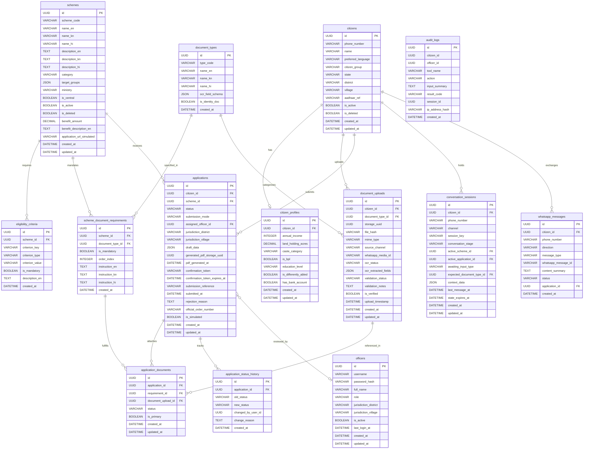

# Gram Saathi — Database Schema

> **Target DB**: SQLite (MVP) → PostgreSQL (production)
> **ORM**: SQLAlchemy (async) | **Migrations**: Alembic
> **Version**: 2.0 (WhatsApp-First Platform Architecture)

---

## 1. Design Principles

| Principle | Implementation |
|-----------|---------------|
| **Minimal PII** | Phone number is the primary identity key (E.164 format). Optional name. No bank account numbers ever. |
| **Aadhaar Protection** | Stored only as masked reference `XXXX-XXXX-1234` or SHA-256 hash — **never plaintext**. Never sent to Gemini. |
| **Bank Accounts** | **Never stored** anywhere in the database. `has_bank_account` is a boolean flag only. |
| **Private Document Storage** | Stored on disk in private `storage/` with UUID filenames (e.g. `9b1deb4d...uuid.pdf`). Original filenames discarded. DB holds only the UUID reference. No public URLs. |
| **Document Lifecycle** | Explicit tracking of ownership, scheme requirement association, OCR extraction status, validation result (`VALID`, `NEEDS_CORRECTION`), and re-upload correction prompts. |
| **Multi-Day Conversation Persistence** | `conversation_sessions` persisted in database keyed by phone number; retains stage, active scheme, active application, and input expectations across multi-day gaps. |
| **Formal State Machine** | Strict application status enums with audit history and role-based transition constraints. |
| **Timestamps** | All tables include `created_at` and `updated_at` (UTC). |
| **Soft-Delete** | `is_deleted` boolean on mutable entities (citizens, schemes) instead of hard `DELETE`. |
| **Audit Trail** | All sensitive actions logged in `audit_logs` without personal identifiers in summaries. |

---

## 2. Entity Relationship Diagram



---

## 3. Table Definitions

### 3.1 `citizens`
Primary citizen identity table. Phone number is the immutable login & WhatsApp sender key.

| Column | Type | Nullable | Default | Description |
|--------|------|----------|---------|-------------|
| `id` | UUID | NOT NULL | `uuid4()` | Primary key |
| `phone_number` | VARCHAR(15) | NOT NULL | — | E.164 format, e.g. `+919876543210`. UNIQUE & INDEXED. |
| `name` | VARCHAR(100) | YES | NULL | Optional citizen-provided display name. |
| `preferred_language` | ENUM(`kn`,`hi`) | NOT NULL | `kn` | Dialogue and notification language preference. |
| `citizen_group` | ENUM | YES | NULL | `FARMER`, `STUDENT`, `WOMAN_ENTREPRENEUR`, `SHG_MEMBER`, `HOME_WORKER`, `WAGE_WORKER`. |
| `state` | VARCHAR(50) | YES | NULL | State of residence (default: Karnataka). |
| `district` | VARCHAR(50) | YES | NULL | District of residence (used for officer routing). |
| `village` | VARCHAR(100) | YES | NULL | Village / Gram Panchayat. |
| `aadhaar_ref` | VARCHAR(20) | YES | NULL | Masked reference only: `XXXX-XXXX-1234`. Never plaintext. |
| `is_active` | BOOLEAN | NOT NULL | `true` | Account active flag. |
| `is_deleted` | BOOLEAN | NOT NULL | `false` | Soft-delete flag. |
| `created_at` | DATETIME | NOT NULL | `now()` | UTC creation timestamp. |
| `updated_at` | DATETIME | NOT NULL | `now()` | UTC update timestamp. |

---

### 3.2 `citizen_profiles`
Extended socio-economic profile used for deterministic eligibility calculation.

| Column | Type | Nullable | Default | Description |
|--------|------|----------|---------|-------------|
| `id` | UUID | NOT NULL | `uuid4()` | Primary key |
| `citizen_id` | UUID | NOT NULL | — | FK → `citizens.id` (UNIQUE) |
| `annual_income` | INTEGER | YES | NULL | Annual family income in INR (integer). |
| `land_holding_acres` | DECIMAL(6,2) | YES | NULL | Cultivable land owned in acres (farmers). |
| `caste_category` | ENUM | YES | NULL | `GEN`, `OBC`, `SC`, `ST`, `EWS`. |
| `is_bpl` | BOOLEAN | YES | NULL | Below Poverty Line ration card holder flag. |
| `education_level` | ENUM | YES | NULL | `NONE`, `PRIMARY`, `SECONDARY`, `HIGHER_SECONDARY`, `GRADUATE`, `POST_GRADUATE`. |
| `is_differently_abled` | BOOLEAN | NOT NULL | `false` | Disability status flag. |
| `has_bank_account` | BOOLEAN | YES | NULL | Bank account existence flag (NOTE: **NO account numbers stored**). |
| `created_at` | DATETIME | NOT NULL | `now()` | UTC creation timestamp. |
| `updated_at` | DATETIME | NOT NULL | `now()` | UTC update timestamp. |

---

### 3.3 `schemes`
Master catalogue of welfare schemes with multilingual titles and descriptions.

| Column | Type | Nullable | Default | Description |
|--------|------|----------|---------|-------------|
| `id` | UUID | NOT NULL | `uuid4()` | Primary key |
| `scheme_code` | VARCHAR(50) | NOT NULL | — | Unique code, e.g. `PM_KISAN_2024`. UNIQUE. |
| `name_en` | VARCHAR(200) | NOT NULL | — | Scheme title in English. |
| `name_kn` | VARCHAR(200) | YES | NULL | Scheme title in Kannada (ಕನ್ನಡ). |
| `name_hi` | VARCHAR(200) | YES | NULL | Scheme title in Hindi (हिंदी). |
| `description_en` | TEXT | YES | NULL | Overview in English. |
| `description_kn` | TEXT | YES | NULL | Overview in Kannada. |
| `description_hi` | TEXT | YES | NULL | Overview in Hindi. |
| `category` | ENUM | NOT NULL | — | `AGRICULTURE`, `EDUCATION`, `WOMEN_WELFARE`, `EMPLOYMENT`, `HOUSING`, `HEALTH`, `SOCIAL_SECURITY`. |
| `target_groups` | JSON | NOT NULL | `[]` | Array of eligible citizen groups. |
| `ministry` | VARCHAR(100) | YES | NULL | Sponsoring department or ministry. |
| `is_central` | BOOLEAN | NOT NULL | `true` | `true` = Central scheme, `false` = State scheme. |
| `is_active` | BOOLEAN | NOT NULL | `true` | Whether scheme is currently accepting applications. |
| `is_deleted` | BOOLEAN | NOT NULL | `false` | Soft-delete flag. |
| `benefit_amount` | DECIMAL(12,2)| YES | NULL | Primary financial benefit in INR. |
| `benefit_description_en` | TEXT | YES | NULL | Narrative benefit description. |
| `application_url_simulated`| VARCHAR(500) | YES | NULL | Simulated portal URL. |
| `created_at` | DATETIME | NOT NULL | `now()` | UTC creation timestamp. |
| `updated_at` | DATETIME | NOT NULL | `now()` | UTC update timestamp. |

---

### 3.4 `eligibility_criteria`
Deterministic rules evaluated by the eligibility engine (NOT by Gemini).

| Column | Type | Nullable | Default | Description |
|--------|------|----------|---------|-------------|
| `id` | UUID | NOT NULL | `uuid4()` | Primary key |
| `scheme_id` | UUID | NOT NULL | — | FK → `schemes.id` |
| `criterion_key` | VARCHAR(100) | NOT NULL | — | Profile attribute, e.g. `annual_income`, `land_holding_acres`. |
| `criterion_type`| ENUM | NOT NULL | — | `NUMERIC_MAX`, `NUMERIC_MIN`, `BOOLEAN_TRUE`, `ENUM_IN`, `ENUM_NOT_IN`. |
| `criterion_value`| VARCHAR(500) | NOT NULL | — | Threshold or JSON array of allowed enum values. |
| `is_mandatory` | BOOLEAN | NOT NULL | `true` | Mandatory vs optional criterion. |
| `description_en` | TEXT | YES | NULL | Explanation of criterion. |
| `created_at` | DATETIME | NOT NULL | `now()` | UTC timestamp. |

---

### 3.5 `document_types`
Catalogue of supported document types and expected OCR extraction schemas.

| Column | Type | Nullable | Default | Description |
|--------|------|----------|---------|-------------|
| `id` | UUID | NOT NULL | `uuid4()` | Primary key |
| `type_code` | VARCHAR(50) | NOT NULL | — | Code, e.g. `AADHAAR`, `LAND_RECORD`, `INCOME_CERT`, `CASTE_CERT`, `MARKSHEET`. UNIQUE. |
| `name_en` | VARCHAR(200) | NOT NULL | — | English name. |
| `name_kn` | VARCHAR(200) | YES | NULL | Kannada name. |
| `name_hi` | VARCHAR(200) | YES | NULL | Hindi name. |
| `ocr_field_schema` | JSON | NOT NULL | `{}` | JSON schema of expected extracted fields (e.g. name, masked_aadhaar, land_acres). |
| `is_identity_doc` | BOOLEAN | NOT NULL | `false` | True for Aadhaar/Voter ID (enforces extra privacy guards). |
| `created_at` | DATETIME | NOT NULL | `now()` | UTC timestamp. |

---

### 3.6 `scheme_document_requirements`
**Key Table for Dynamic Document Requests**: Defines the required documents for each scheme and localized instructions sent to citizens on WhatsApp.

| Column | Type | Nullable | Default | Description |
|--------|------|----------|---------|-------------|
| `id` | UUID | NOT NULL | `uuid4()` | Primary key |
| `scheme_id` | UUID | NOT NULL | — | FK → `schemes.id` |
| `document_type_id` | UUID | NOT NULL | — | FK → `document_types.id` |
| `is_mandatory` | BOOLEAN | NOT NULL | `true` | Must be provided before application can advance. |
| `order_index` | INTEGER | NOT NULL | `1` | Sequence in which WhatsApp prompts for documents. |
| `instruction_en` | TEXT | YES | NULL | English guidance (e.g. "Take a clear photo of your Pahani/RTC"). |
| `instruction_kn` | TEXT | YES | NULL | Kannada guidance (e.g. "ದಯವಿಟ್ಟು ನಿಮ್ಮ ಪಹಣಿ/ಆರ್‌ಟಿಸಿ ಪ್ರತಿಯ ಸ್ಪಷ್ಟ ಫೋಟೋ ಕಳುಹಿಸಿ"). |
| `instruction_hi` | TEXT | YES | NULL | Hindi guidance (e.g. "कृपया अपने भूमि अभिलेख/खतौनी की साफ़ फ़ोटो भेजें"). |
| `created_at` | DATETIME | NOT NULL | `now()` | UTC timestamp. |

---

### 3.7 `document_uploads`
Uploaded files tracking private disk location, OCR extraction, and validation status.

| Column | Type | Nullable | Default | Description |
|--------|------|----------|---------|-------------|
| `id` | UUID | NOT NULL | `uuid4()` | Primary key |
| `citizen_id` | UUID | NOT NULL | — | FK → `citizens.id` |
| `document_type_id` | UUID | NOT NULL | — | FK → `document_types.id` |
| `storage_uuid` | UUID | NOT NULL | — | Filename on private disk (`storage/<uuid>`). No public URL. |
| `file_hash` | VARCHAR(64) | NOT NULL | — | SHA-256 hash for integrity validation. |
| `mime_type` | VARCHAR(50) | NOT NULL | — | `image/jpeg`, `image/png`, or `application/pdf`. |
| `source_channel` | ENUM | NOT NULL | `WHATSAPP` | `WHATSAPP` or `PWA`. |
| `whatsapp_media_id` | VARCHAR(100) | YES | NULL | Meta media ID (ephemeral, downloaded immediately). |
| `ocr_status` | ENUM | NOT NULL | `PENDING` | `PENDING`, `PROCESSING`, `DONE`, `FAILED`. |
| `ocr_extracted_fields`| JSON | YES | NULL | Structured key-values extracted by local OCR. |
| `validation_status` | ENUM | NOT NULL | `PENDING` | `PENDING`, `VALID`, `INVALID`, `NEEDS_CORRECTION`. |
| `validation_notes` | TEXT | YES | NULL | Explanation if correction required (e.g. "Photo is blurry"). |
| `is_verified` | BOOLEAN | NOT NULL | `false` | True when validation passes. |
| `upload_timestamp` | DATETIME | NOT NULL | `now()` | Upload time. |
| `created_at` | DATETIME | NOT NULL | `now()` | UTC timestamp. |
| `updated_at` | DATETIME | NOT NULL | `now()` | UTC timestamp. |

---

### 3.8 `applications`
Complete application entity tracking compilation, PDF generation, citizen confirmation, and review status.

| Column | Type | Nullable | Default | Description |
|--------|------|----------|---------|-------------|
| `id` | UUID | NOT NULL | `uuid4()` | Primary key |
| `citizen_id` | UUID | NOT NULL | — | FK → `citizens.id` |
| `scheme_id` | UUID | NOT NULL | — | FK → `schemes.id` |
| `status` | ENUM | NOT NULL | `DRAFT` | Complete State Machine: `DRAFT`, `ELIGIBILITY_CHECKED`, `DOCUMENTS_PENDING`, `DOCUMENTS_UNDER_REVIEW`, `CORRECTION_REQUIRED`, `READY_FOR_REVIEW`, `PREVIEW_GENERATED`, `CITIZEN_CONFIRMED`, `SUBMITTED`, `OFFICER_REVIEW`, `APPROVED`, `REJECTED`. |
| `submission_mode` | ENUM | NOT NULL | `DIRECT_CITIZEN` | `DIRECT_CITIZEN` or `ASSISTED_OFFICIAL`. |
| `assigned_officer_id` | UUID | YES | NULL | FK → `officers.id` (when assigned for assisted review). |
| `jurisdiction_district` | VARCHAR(50) | YES | NULL | District for officer routing. |
| `jurisdiction_village` | VARCHAR(100) | YES | NULL | Village for officer routing. |
| `draft_data` | JSON | NOT NULL | `{}` | Compiled application payload (structured answers, no raw doc bytes). |
| `generated_pdf_storage_uuid` | UUID | YES | NULL | Storage UUID of the compiled official PDF in `storage/`. |
| `pdf_generated_at` | DATETIME | YES | NULL | When application PDF was rendered. |
| `confirmation_token` | VARCHAR(64) | YES | NULL | Single-use 5-minute confirmation token. |
| `confirmation_token_expires_at`| DATETIME | YES | NULL | Expiration timestamp (5 min TTL). |
| `submission_reference` | VARCHAR(100) | YES | NULL | E.g. `SIM-2024-XXXXXX` (always prefixed `SIM-` in MVP). |
| `submitted_at` | DATETIME | YES | NULL | Timestamp of verified confirmation. |
| `rejection_reason` | TEXT | YES | NULL | Stated reason if rejected by officer. |
| `official_order_number` | VARCHAR(100) | YES | NULL | Formal decision reference number from officer. |
| `is_simulated` | BOOLEAN | NOT NULL | `true` | Always `true` in simulation mode. |
| `created_at` | DATETIME | NOT NULL | `now()` | UTC creation timestamp. |
| `updated_at` | DATETIME | NOT NULL | `now()` | UTC update timestamp. |

---

### 3.9 `application_documents`
Links verified document uploads to specific scheme document requirements.

| Column | Type | Nullable | Default | Description |
|--------|------|----------|---------|-------------|
| `id` | UUID | NOT NULL | `uuid4()` | Primary key |
| `application_id` | UUID | NOT NULL | — | FK → `applications.id` |
| `requirement_id` | UUID | NOT NULL | — | FK → `scheme_document_requirements.id` |
| `document_upload_id` | UUID | YES | NULL | FK → `document_uploads.id` |
| `status` | ENUM | NOT NULL | `REQUESTED` | `REQUESTED`, `UPLOADED`, `VERIFIED`, `REJECTED`, `REPLACED`. |
| `is_primary` | BOOLEAN | NOT NULL | `true` | Primary document for requirement. |
| `created_at` | DATETIME | NOT NULL | `now()` | UTC timestamp. |
| `updated_at` | DATETIME | NOT NULL | `now()` | UTC timestamp. |

---

### 3.10 `application_status_history`
Immutable audit log of all application state transitions.

| Column | Type | Nullable | Default | Description |
|--------|------|----------|---------|-------------|
| `id` | UUID | NOT NULL | `uuid4()` | Primary key |
| `application_id` | UUID | NOT NULL | — | FK → `applications.id` |
| `old_status` | VARCHAR(50) | YES | NULL | Previous status. |
| `new_status` | VARCHAR(50) | NOT NULL | — | New status. |
| `changed_by_user_id`| UUID | YES | NULL | Officer ID or Citizen ID or `NULL` (System). |
| `change_reason` | TEXT | YES | NULL | Narrative reason (e.g. "Citizen confirmed via WhatsApp"). |
| `created_at` | DATETIME | NOT NULL | `now()` | UTC timestamp. |

---

### 3.11 `officers`
Panchayat and Tehsil staff accounts for the role-protected web portal.

| Column | Type | Nullable | Default | Description |
|--------|------|----------|---------|-------------|
| `id` | UUID | NOT NULL | `uuid4()` | Primary key |
| `username` | VARCHAR(100) | NOT NULL | — | Login username. UNIQUE. |
| `password_hash` | VARCHAR(200) | NOT NULL | — | bcrypt hash (`passlib`). |
| `full_name` | VARCHAR(100) | NOT NULL | — | Officer display name. |
| `role` | ENUM | NOT NULL | — | `PANCHAYAT_STAFF`, `TEHSIL_STAFF`, `ADMIN`. |
| `jurisdiction_district`| VARCHAR(50)| YES | NULL | E.g. "Mandya". |
| `jurisdiction_village` | VARCHAR(100)| YES | NULL | E.g. "Maddur". |
| `is_active` | BOOLEAN | NOT NULL | `true` | Active status. |
| `last_login_at` | DATETIME | YES | NULL | Last login timestamp. |
| `created_at` | DATETIME | NOT NULL | `now()` | UTC creation timestamp. |
| `updated_at` | DATETIME | NOT NULL | `now()` | UTC update timestamp. |

---

### 3.12 `conversation_sessions`
**Persistent Conversation Engine Table**: Tracks dialogue stage, active application, and input expectations across multi-day interruptions.

| Column | Type | Nullable | Default | Description |
|--------|------|----------|---------|-------------|
| `id` | UUID | NOT NULL | `uuid4()` | Primary key |
| `citizen_id` | UUID | YES | NULL | FK → `citizens.id` |
| `phone_number` | VARCHAR(20) | NOT NULL | — | E.164 phone number. INDEXED for instant WhatsApp lookup. |
| `channel` | ENUM | NOT NULL | `WHATSAPP` | `WHATSAPP` or `PWA`. |
| `session_key` | VARCHAR(200) | NOT NULL | — | Phone number or browser token. UNIQUE. |
| `conversation_stage` | ENUM | NOT NULL | `GREETING` | `GREETING`, `DISCOVERY`, `ELIGIBILITY`, `DOC_COLLECTION`, `APPLICATION_REVIEW`, `CONFIRMATION_PENDING`, `ASSISTED_HANDOFF`, `TRACKING`, `IDLE`. |
| `active_scheme_id` | UUID | YES | NULL | FK → `schemes.id` currently being explored. |
| `active_application_id` | UUID | YES | NULL | FK → `applications.id` currently in progress. |
| `awaiting_input_type` | ENUM | NOT NULL | `TEXT` | `TEXT`, `DOCUMENT_UPLOAD`, `CONFIRMATION_CHOICE`, `LOCATION`, `CRITERIA_ANSWER`. |
| `expected_document_type_id` | UUID | YES | NULL | FK → `document_types.id` (when awaiting a specific document upload). |
| `context_data` | JSON | NOT NULL | `{}` | Slots, recent intent, language preference (`kn`/`hi`). No sensitive PII. |
| `last_message_at` | DATETIME | NOT NULL | `now()` | Timestamp of last received message. |
| `state_expires_at` | DATETIME | NOT NULL | — | Expiry timestamp (defaults to 30 days for long persistence). |
| `created_at` | DATETIME | NOT NULL | `now()` | UTC creation timestamp. |
| `updated_at` | DATETIME | NOT NULL | `now()` | UTC update timestamp. |

---

### 3.13 `whatsapp_messages`
Tracks all inbound and outbound WhatsApp messages and delivery statuses without storing PII.

| Column | Type | Nullable | Default | Description |
|--------|------|----------|---------|-------------|
| `id` | UUID | NOT NULL | `uuid4()` | Primary key |
| `citizen_id` | UUID | YES | NULL | FK → `citizens.id` |
| `phone_number` | VARCHAR(20) | NOT NULL | — | E.164 phone number. |
| `direction` | ENUM | NOT NULL | — | `INBOUND` (citizen to bot) or `OUTBOUND` (bot to citizen). |
| `message_type` | ENUM | NOT NULL | — | `TEXT`, `IMAGE`, `DOCUMENT`, `INTERACTIVE_BUTTON`, `TEMPLATE`. |
| `whatsapp_message_id`| VARCHAR(100) | YES | NULL | Meta wamid ID. |
| `content_summary` | TEXT | YES | NULL | Abstract summary (e.g. "Uploaded land record", "Status alert: Approved"). No PII. |
| `status` | ENUM | NOT NULL | `SENT` | `RECEIVED`, `SENT`, `DELIVERED`, `READ`, `FAILED`. |
| `application_id` | UUID | YES | NULL | FK → `applications.id` (if related to an application). |
| `created_at` | DATETIME | NOT NULL | `now()` | UTC timestamp. |

---

### 3.14 `audit_logs`
Append-only tamper-resistant system audit trail.

| Column | Type | Nullable | Default | Description |
|--------|------|----------|---------|-------------|
| `id` | UUID | NOT NULL | `uuid4()` | Primary key |
| `citizen_id` | UUID | YES | NULL | Citizen UUID only (no name/phone). |
| `officer_id` | UUID | YES | NULL | Officer UUID only. |
| `tool_name` | VARCHAR(100) | NOT NULL | — | Name of allowlisted tool called. |
| `action` | VARCHAR(200) | NOT NULL | — | High-level action (e.g. `CONFIRM_APPLICATION`). |
| `input_summary` | TEXT | NOT NULL | — | Safe summary containing **zero personal data**. |
| `result_code` | VARCHAR(50) | NOT NULL | — | `SUCCESS`, `VALIDATION_FAILED`, `TOKEN_EXPIRED`. |
| `session_id` | UUID | YES | NULL | Conversation session reference. |
| `ip_address_hash` | VARCHAR(64) | YES | NULL | SHA-256 hash of client IP. |
| `created_at` | DATETIME | NOT NULL | `now()` | UTC creation timestamp. |

---

## 4. Synthetic Seed Data Specification

### 4.1 Document Types
```json
[
  {
    "type_code": "AADHAAR",
    "name_en": "Aadhaar Card",
    "name_kn": "ಆಧಾರ್ ಕಾರ್ಡ್",
    "name_hi": "आधार कार्ड",
    "is_identity_doc": true,
    "ocr_field_schema": {"name": "string", "masked_aadhaar": "string", "yob": "integer", "gender": "string"}
  },
  {
    "type_code": "LAND_RECORD",
    "name_en": "Land Record (Pahani / RTC / Khatauni)",
    "name_kn": "ಪಹಣಿ / ಆರ್‌ಟಿಸಿ ಭೂ ದಾಖಲೆ",
    "name_hi": "भूमि अभिलेख / खतौनी",
    "is_identity_doc": false,
    "ocr_field_schema": {"owner_name": "string", "survey_number": "string", "land_acres": "float", "district": "string"}
  },
  {
    "type_code": "INCOME_CERT",
    "name_en": "Income Certificate",
    "name_kn": "ಆದಾಯ ಪ್ರಮಾಣಪತ್ರ",
    "name_hi": "आय प्रमाण पत्र",
    "is_identity_doc": false,
    "ocr_field_schema": {"applicant_name": "string", "annual_income": "integer", "valid_until": "string"}
  },
  {
    "type_code": "MARKSHEET",
    "name_en": "10th / 12th Marksheet",
    "name_kn": "ಅಂಕಪಟ್ಟಿ (10 / 12 ನೇ ತರಗತಿ)",
    "name_hi": "अंकसूची (10वीं / 12वीं)",
    "is_identity_doc": false,
    "ocr_field_schema": {"student_name": "string", "roll_number": "string", "percentage": "float"}
  }
]
```

### 4.2 Dynamic Document Requirements Mapping
```json
[
  {
    "scheme_code": "PM_KISAN_2024",
    "requirements": [
      {
        "document_type_code": "AADHAAR",
        "is_mandatory": true,
        "order_index": 1,
        "instruction_en": "Please send a clear photo of your Aadhaar card.",
        "instruction_kn": "ದಯವಿಟ್ಟು ನಿಮ್ಮ ಆಧಾರ್ ಕಾರ್ಡ್‌ನ ಸ್ಪಷ್ಟ ಫೋಟೋ ಕಳುಹಿಸಿ.",
        "instruction_hi": "कृपया अपने आधार कार्ड की साफ़ फ़ोटो भेजें।"
      },
      {
        "document_type_code": "LAND_RECORD",
        "is_mandatory": true,
        "order_index": 2,
        "instruction_en": "Please send a clear photo of your Pahani / RTC (Land Record).",
        "instruction_kn": "ದಯವಿಟ್ಟು ನಿಮ್ಮ ಪಹಣಿ / ಆರ್‌ಟಿಸಿ (ಭೂ ದಾಖಲೆ) ಪ್ರತಿಯ ಸ್ಪಷ್ಟ ಫೋಟೋ ಕಳುಹಿಸಿ.",
        "instruction_hi": "कृपया अपनी खतौनी / भूमि अभिलेख की साफ़ फ़ोटो भेजें।"
      }
    ]
  },
  {
    "scheme_code": "NSP_POST_MATRIC_SC_2024",
    "requirements": [
      {
        "document_type_code": "AADHAAR",
        "is_mandatory": true,
        "order_index": 1,
        "instruction_en": "Please send a clear photo of your Aadhaar card.",
        "instruction_kn": "ದಯವಿಟ್ಟು ನಿಮ್ಮ ಆಧಾರ್ ಕಾರ್ಡ್‌ನ ಸ್ಪಷ್ಟ ಫೋಟೋ ಕಳುಹಿಸಿ.",
        "instruction_hi": "कृपया अपने आधार कार्ड की साफ़ फ़ोटो भेजें।"
      },
      {
        "document_type_code": "INCOME_CERT",
        "is_mandatory": true,
        "order_index": 2,
        "instruction_en": "Please send your Income Certificate photo.",
        "instruction_kn": "ದಯವಿಟ್ಟು ನಿಮ್ಮ ಆದಾಯ ಪ್ರಮಾಣಪತ್ರದ ಫೋಟೋ ಕಳುಹಿಸಿ.",
        "instruction_hi": "कृपया अपने आय प्रमाण पत्र की फ़ोटो भेजें।"
      },
      {
        "document_type_code": "MARKSHEET",
        "is_mandatory": true,
        "order_index": 3,
        "instruction_en": "Please send your previous year marksheet.",
        "instruction_kn": "ದಯವಿಟ್ಟು ನಿಮ್ಮ ಹಿಂದಿನ ತರಗತಿಯ ಅಂಕಪಟ್ಟಿ ಕಳುಹಿಸಿ.",
        "instruction_hi": "कृपया अपनी पिछली कक्षा की अंकसूची भेजें।"
      }
    ]
  }
]
```

---

*Last Updated: 2026-11-13 | Schema Revision 2.0 (WhatsApp-First Platform)*
