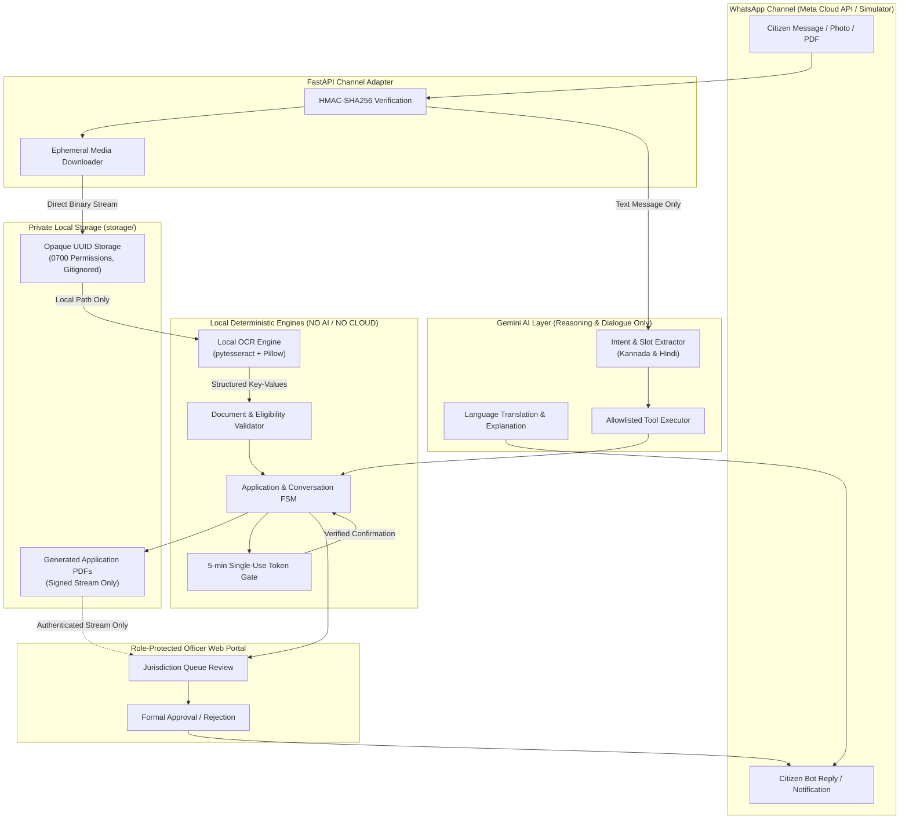

# PRIVACY_DATA_FLOW.md — Gram Saathi

> **Document Type**: Data Flow & Privacy Architecture Reference (WhatsApp-First)
> **Audience**: Developers, security reviewers, AI coding agents
> **Related**: [`PRIVACY_SECURITY.md`](../PRIVACY_SECURITY.md)
> **Version**: 2.0

This document details how data flows through Gram Saathi's WhatsApp-first architecture — tracking collection, ingestion, private storage, local processing, and the strict boundary isolating the Gemini AI layer from sensitive citizen PII.

---

## 1. End-to-End System Data Flow Overview



---

## 2. WhatsApp Ingestion & Phone Number Handling

In WhatsApp, the citizen's phone number (`From: +919876543210`) is the routing address.

### Step-by-Step Flow:
1. **Webhook Ingestion**:
   - Meta webhook sends POST to `/api/v1/whatsapp/webhook`.
   - Backend validates `X-Hub-Signature-256` HMAC using constant-time comparison (`hmac.compare_digest`).
2. **Citizen Record Lookup**:
   - Backend matches phone number in `citizens.phone_number`.
   - If not found: creates a new minimal record (`preferred_language='kn'`, `citizen_group=NULL`).
3. **Privacy Controls**:
   - The phone number is stored in the DB solely to route WhatsApp responses and status notifications.
   - **Never sent to Gemini**: Phone numbers are stripped before passing context to Gemini prompts.
   - **Never logged in plaintext**: Audit logs use `citizen_id` (UUID), never phone numbers.
   - **Never returned in officer lists**: The officer dashboard list view shows only application ID, village, and status.

---

## 3. Dynamic Document Upload & Local OCR Processing

```
Step 1: Citizen sends photo of land record (RTC/Pahani) via WhatsApp
        → Meta Webhook delivers media payload: { "type": "image", "id": "media_98234" }

Step 2: Backend Media Downloader
        → Requests media URL from Meta Graph API using backend bearer token.
        → Streams bytes directly into private `storage/<storage_uuid>.jpg`.
        → Calculates SHA-256 checksum: `file_hash`.
        → Original filename is discarded; storage_uuid is an opaque UUID.
        → Raw media URL from Meta expires within 5 minutes and is never stored.

Step 3: Local OCR Processing (Local Machine Only)
        → Backend spawns local pytesseract process.
        → Pillow applies grayscale, contrast stretching, and rotation correction.
        → pytesseract executes locally (languages: eng + kan + hin).
        → Extracts structured key-values:
          { "owner_name": "Ramu Nayak", "land_acres": 1.8, "survey_number": "45/2" }
        → [ABSOLUTE RULE]: Raw image bytes are NEVER sent to Gemini API.

Step 4: Deterministic Validation
        → Readability score calculated.
        → If score < 60% or required fields missing:
          - Marks `validation_status = NEEDS_CORRECTION`.
          - Proactively messages citizen on WhatsApp:
            "ಚಿತ್ರವು ಅಸ್ಪಷ್ಟವಾಗಿದೆ. ದಯವಿಟ್ಟು ಬೆಳಕಿನಲ್ಲಿ ಸ್ಪಷ್ಟವಾದ ಫೋಟೋವನ್ನು ಪುನಃ ಕಳುಹಿಸಿ."
        → If valid:
          - Marks `validation_status = VALID`.
          - Marks requirement fulfilled in `application_documents`.
```

---

## 4. Application Compilation & Secure PDF Generation

```
Step 1: Verified Data Aggregation
        → Combines verified citizen profile + verified OCR fields.
        → Compiles into structured `draft_data` JSON.

Step 2: Local PDF Rendering
        → `services/pdf_service.py` renders official application summary PDF.
        → Embeds: Emblem header, applicant details, attached document hashes, declaration.
        → Saves PDF directly to `storage/<pdf_uuid>.pdf` (private).
        → No public URL is generated.

Step 3: Preview Delivery to Citizen
        → WhatsApp text summary sent to citizen.
        → If requested, generates short-lived signed preview token (TTL: 10 minutes)
          accessible only via `/api/v1/applications/{id}/pdf?token=...`.
```

---

## 5. Consequential Confirmation Token Lifecycle

```
Step 1: Generation
        → Token generated: `secrets.token_urlsafe(32)` (cryptographically random).
        → Stored on `applications.confirmation_token`.
        → Expiry set: `now() + 5 minutes`.

Step 2: WhatsApp Prompt
        → Citizen sent interactive button: [Confirm Submission]
        → Or prompt: "Reply 'YES' to confirm this application is accurate."

Step 3: Verification
        → Citizen replies within 5 minutes.
        → Backend checks:
          - Token matches application.
          - Token has not expired (≤ 5 minutes).
          - Token has not been consumed.
        → On success: Token is immediately set to NULL (single-use guarantee).
        → Status advances to `SUBMITTED` or `OFFICER_REVIEW`.
```

---

## 6. Officer Review & Decision Data Flow

```
Step 1: Officer Authentication
        → Officer logs in at `/api/v1/auth/officer/login` via desktop browser.
        → JWT issued with role (`PANCHAYAT_STAFF`, `TEHSIL_STAFF`) and jurisdiction.

Step 2: Scoped Query
        → Officer opens Application Queue.
        → FastAPI dependency automatically injects jurisdiction filter:
          `WHERE jurisdiction_district = officer.district AND jurisdiction_village = officer.village`.

Step 3: Document Inspection
        → Officer views application details and OCR extraction.
        → Document images and PDFs streamed via authenticated streaming endpoints.
        → Static public links are never used.

Step 4: Formal Decision
        → Officer enters official government order number (Approval) or reason (Rejection).
        → Decision committed to `application_status_history` with `changed_by_user_id = officer.id`.
        → Backend Notification Dispatcher sends instant WhatsApp alert to citizen.
```

---

## 7. Strict AI Privacy Boundary: What Goes to Gemini vs What Stays Backend

| Data Item | Sent to Gemini? | Handled Where? | Rationale |
|---|---|---|---|
| **Raw Image / PDF Bytes** | ❌ **NEVER** | Local `storage/` & `ocr_service.py` | Prevents document exposure to external APIs |
| **Aadhaar Number (Plaintext)** | ❌ **NEVER** | Never stored anywhere | Hard security stop |
| **Masked Aadhaar (`XXXX-XXXX-1234`)** | ❌ **NEVER** | Stored in DB; omitted from AI prompts | Not needed for dialogue reasoning |
| **Bank Account Numbers** | ❌ **NEVER** | Never accepted or stored | Extreme risk; boolean flag `has_bank_account` only |
| **Full Citizen Name** | ❌ **NEVER** | DB only; optional greeting placeholder | Not required for eligibility or scheme matching |
| **Citizen Phone Number** | ❌ **NEVER** | WhatsApp routing layer only | Stripped before Gemini prompt construction |
| **Raw OCR Text Dumps** | ❌ **NEVER** | OCR service only | Only structured field keys needed |
| **Citizen Group (e.g. `FARMER`)** | ✅ **YES** | AI prompt context | Necessary to recommend relevant schemes |
| **Land Holding Acreage** | ✅ **YES** | Eligibility tool argument | Necessary to assess scheme criteria |
| **Annual Family Income** | ✅ **YES** | Eligibility tool argument | Necessary to assess scholarship thresholds |
| **Citizen Question in Kannada/Hindi** | ✅ **YES** | AI prompt message | Required for multilingual NLU & dialogue |
| **Scheme Details & Criteria** | ✅ **YES** | Tool response context | Required to explain benefits empathetically |

---

## 8. Data Retention & Deletion Policy

| Category | Storage Location | Retention Period | Deletion Mechanism |
|---|---|---|---|
| **Uploaded Document Photos** | `storage/<uuid>.*` | 7 days after official decision | Automated cleanup worker |
| **Generated Application PDFs** | `storage/<uuid>.pdf` | 30 days after official decision | Automated cleanup worker |
| **Confirmation Tokens** | `applications.confirmation_token` | 5 minutes | Set to `NULL` upon use or expiry |
| **Conversation Sessions** | `conversation_sessions` | 30 days of inactivity | Scheduled DB purge |
| **Audit Logs** | `audit_logs` table | 90 days minimum | Immutable, append-only |

---

*Last Updated: 2026-11-13 | Privacy Data Flow Revision 2.0 (WhatsApp-First)*
