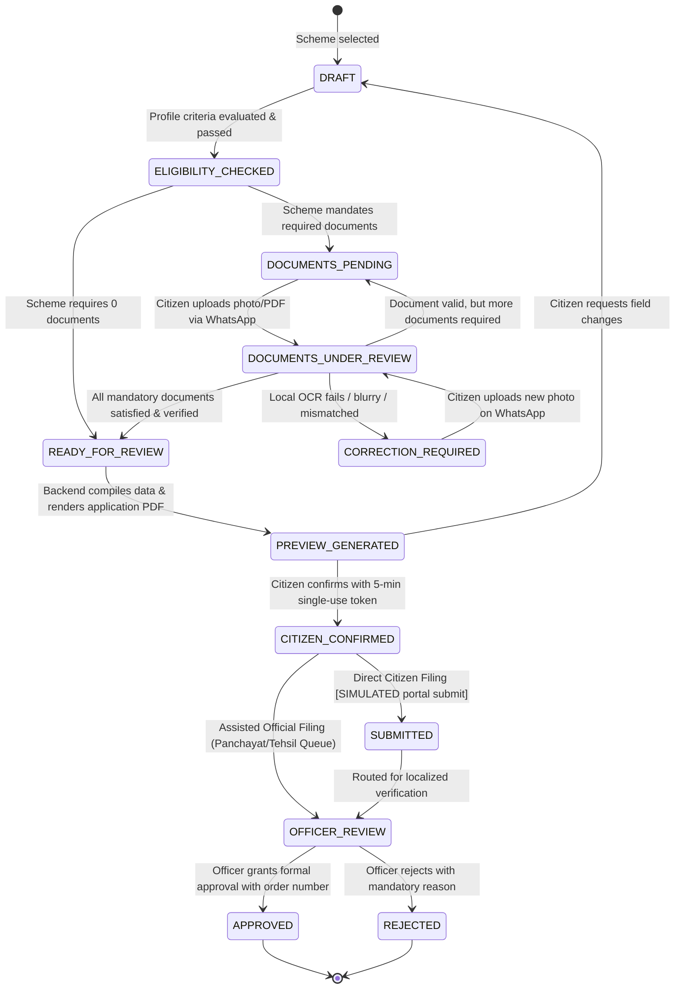
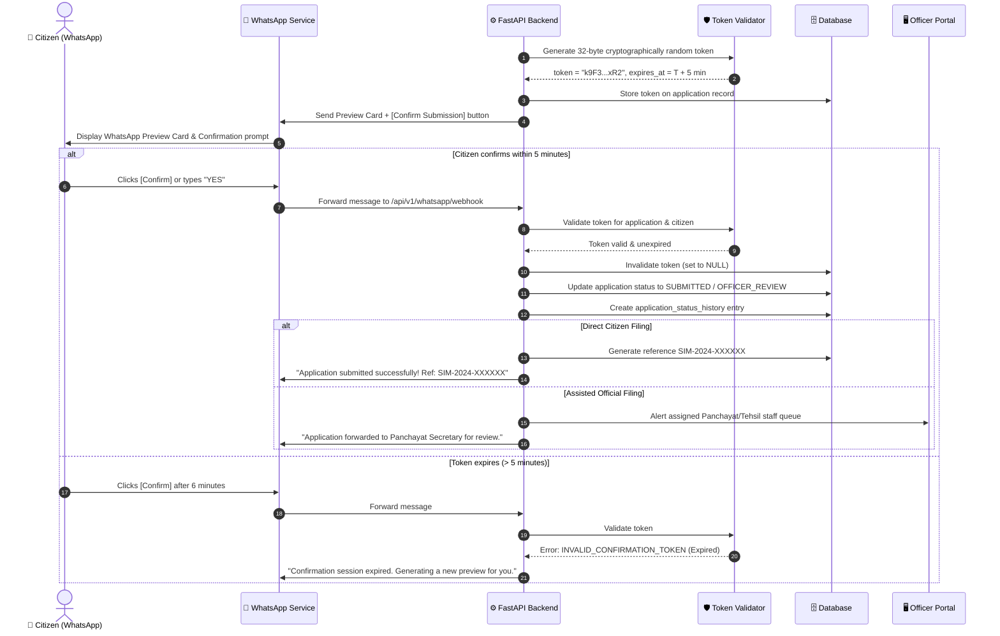

# Gram Saathi — Service Execution Architecture

> **Execution Layer, State Machines, Document Lifecycle & Confirmation Protocol**
> Version: 2.0 | WhatsApp-First Platform Architecture

---

## 1. Core Principles

Gram Saathi is designed to execute real public services, not just generate text. In government service workflows, every state change, document upload, citizen consent, and official decision has legal and administrative consequences.

1. **Deterministic Execution over AI Generative Decisions**:
   - Gemini reasons over natural language, translates, and coordinates.
   - Deterministic backend services execute all eligibility calculations, state transitions, token validations, and database writes.
2. **Strict Consequential Confirmation**:
   - No application is ever submitted or routed for formal processing without explicit, cryptographically verifiable citizen confirmation.
3. **Dynamic Document Lifecycle**:
   - Documents are requested dynamically based on scheme specifications.
   - Uploads are validated locally; blurry or mismatched documents immediately trigger proactive WhatsApp correction requests.
4. **Separation of Citizen Execution and Official Authority**:
   - Citizens confirm their applications.
   - Official decisions (Approval/Rejection) are exclusively reserved for authorised Panchayat and Tehsil officers.

---

## 2. The Persistent Application State Machine

Applications follow a strict, deterministic Finite State Machine (FSM). Arbitrary state jumps are impossible.



### State Transition Matrix & Guards

| Current Status | Next Status | Trigger | Guard Condition / Validation |
|---|---|---|---|
| `DRAFT` | `ELIGIBILITY_CHECKED` | System runs eligibility tool | Mandatory eligibility criteria evaluate to `eligible=true` |
| `ELIGIBILITY_CHECKED` | `DOCUMENTS_PENDING` | System checks scheme requirements | `scheme_document_requirements` has mandatory docs |
| `DOCUMENTS_PENDING` | `DOCUMENTS_UNDER_REVIEW` | Citizen uploads media via WhatsApp | File MIME is `image/*` or `application/pdf`; size ≤ 5MB |
| `DOCUMENTS_UNDER_REVIEW` | `CORRECTION_REQUIRED` | OCR validation service runs | OCR confidence < 60% OR required fields missing/unreadable |
| `CORRECTION_REQUIRED` | `DOCUMENTS_UNDER_REVIEW` | Citizen uploads replacement media | Replacement file ingested and linked to pending requirement |
| `DOCUMENTS_UNDER_REVIEW` | `DOCUMENTS_PENDING` | OCR validation service passes | Upload verified, but other mandatory requirements remain |
| `DOCUMENTS_UNDER_REVIEW` | `READY_FOR_REVIEW` | All requirements verified | 100% of mandatory scheme requirements marked `VERIFIED` |
| `READY_FOR_REVIEW` | `PREVIEW_GENERATED` | PDF generation service runs | Application PDF rendered in `storage/` and token generated |
| `PREVIEW_GENERATED` | `CITIZEN_CONFIRMED` | Citizen sends confirmation on WhatsApp | Token valid, unexpired (≤ 5 min), matching application & citizen |
| `CITIZEN_CONFIRMED` | `SUBMITTED` | ServiceExecutor runs direct filing | Submission mode is `DIRECT_CITIZEN`; portal stub returns ref |
| `CITIZEN_CONFIRMED` | `OFFICER_REVIEW` | System routes to assisted queue | Submission mode is `ASSISTED_OFFICIAL`; assigned to jurisdiction |
| `OFFICER_REVIEW` | `APPROVED` | Officer clicks Approve on Web Portal | User has `PANCHAYAT_STAFF`/`TEHSIL_STAFF` role; order number present |
| `OFFICER_REVIEW` | `REJECTED` | Officer clicks Reject on Web Portal | User has officer role; mandatory rejection reason supplied |

---

## 3. Persistent Multi-Day Conversation State Machine

WhatsApp conversations are persisted in `conversation_sessions` by phone number, enabling seamless resumption when citizens take days to locate documents.

```mermaid
stateDiagram-v2
    [*] --> GREETING : Message received from new phone number
    GREETING --> DISCOVERY : Citizen specifies occupation/need (Kannada/Hindi)
    DISCOVERY --> ELIGIBILITY : Citizen selects scheme from recommendations
    
    ELIGIBILITY --> DOC_COLLECTION : Citizen eligible; missing docs identified
    ELIGIBILITY --> DISCOVERY : Citizen ineligible; alternative schemes suggested
    
    DOC_COLLECTION --> DOC_PROCESSING : Citizen sends image or document
    DOC_PROCESSING --> DOC_COLLECTION : Blurry doc -> correction sent -> awaiting photo
    DOC_PROCESSING --> DOC_COLLECTION : Doc verified -> next requirement requested
    DOC_PROCESSING --> APPLICATION_REVIEW : All documents verified
    
    APPLICATION_REVIEW --> CONFIRMATION_PENDING : PDF preview card sent with 5-min token
    CONFIRMATION_PENDING --> APPLICATION_REVIEW : Token expired (> 5 min) -> new preview issued
    CONFIRMATION_PENDING --> SUBMITTED_TRACKING : Valid token confirmed
    
    SUBMITTED_TRACKING --> IDLE : Submission complete, reference issued
    IDLE --> SUBMITTED_TRACKING : Citizen sends "Status" or checks progress
    IDLE --> DISCOVERY : Citizen asks for a new scheme
```



### Multi-Day Resumption Algorithm
When an incoming WhatsApp webhook arrives:
1. Extract `sender_phone = message.from` (e.g. `919876543210`).
2. Query `SELECT * FROM conversation_sessions WHERE phone_number = :sender_phone`.
3. If no session exists:
   - Create new session in `GREETING` stage.
   - Reply with welcome message and language selection.
4. If session exists and `now() < state_expires_at` (30-day window):
   - Update `last_message_at = now()`.
   - **Case A: `awaiting_input_type == 'DOCUMENT_UPLOAD'`**:
     - If incoming message contains media: route directly to `process_document_upload` with `expected_document_type_id`.
     - If incoming message is text (e.g., "Where can I find RTC?"): answer question using Gemini reasoning, then remind user to upload the document.
   - **Case B: `awaiting_input_type == 'CONFIRMATION_CHOICE'`**:
     - Check if user replied "YES", "ಹೌದು", "हाँ", or clicked interactive button.
     - Validate confirmation token.
   - **Case C: General inquiry after days**:
     - Look up `active_application_id` and resume context:
       *"Namaskara Ramu! You were applying for PM-KISAN. We still need your Land Record. Would you like to upload it now?"*

---

## 4. Dynamic Document Request & Correction Loop

Schemes require specific documents. Gram Saathi dynamically requests only the missing documents, validating each before advancing.

```
                  Citizen selects PM-KISAN
                             │
                             ▼
  Query `scheme_document_requirements` for scheme
  Requirements: 1. AADHAAR (Mandatory), 2. LAND_RECORD (Mandatory)
                             │
                             ▼
  Check existing verified documents for citizen
  Result: Aadhaar already on file; Land Record MISSING
                             │
                             ▼
  WhatsApp message sent to citizen in Kannada:
  "ದಯವಿಟ್ಟು ನಿಮ್ಮ ಪಹಣಿ/ಆರ್‌ಟಿಸಿ (ಭೂ ದಾಖಲೆ) ಪ್ರತಿಯ ಸ್ಪಷ್ಟ ಫೋಟೋ ಕಳುಹಿಸಿ."
  Set `awaiting_input_type = DOCUMENT_UPLOAD`
  Set `expected_document_type_id = LAND_RECORD`
                             │
                             ▼
  Citizen sends photo via WhatsApp
                             │
                             ▼
  Storage service saves file to `storage/<uuid>.jpg`
  OCR service executes locally (pytesseract + Pillow)
                             │
            ┌────────────────┴────────────────┐
            ▼                                 ▼
    [OCR Confident: 85%]              [OCR Low Conf: 35% / Blurry]
    Land area: 1.8 acres              Cannot read Survey Number
    Owner name matches citizen                │
            │                                 ▼
            │                         Set `validation_status = NEEDS_CORRECTION`
            │                         WhatsApp prompt sent:
            │                         "ಫೋಟೋ ಸ್ಪಷ್ಟವಾಗಿಲ್ಲ. ದಯವಿಟ್ಟು ಬೆಳಕಿನಲ್ಲಿ
            │                         ಪುನಃ ಸ್ಪಷ್ಟ ಫೋಟೋ ಕಳುಹಿಸಿ."
            │                         (Stays in DOC_COLLECTION stage)
            ▼
    Set `validation_status = VALID`
    Requirement satisfied!
    All mandatory requirements met -> Advance to `READY_FOR_REVIEW`
```

---

## 5. Application Preparation & PDF Generation

Before asking for citizen confirmation, the system compiles all data into an official-format PDF.

1. **Compilation (`services/application_service.py`)**:
   - Collects verified citizen profile (Name, Phone, Village, District, Category).
   - Collects verified OCR fields (Masked Aadhaar `XXXX-XXXX-1234`, Land Survey Number, Acreage).
   - Serializes into `draft_data` JSON on the `applications` record.
2. **PDF Rendering (`services/pdf_service.py`)**:
   - Generates a formal 1-page A4 application summary using ReportLab / HTML template.
   - Includes government-style header, applicant details, attached document hashes, barcode/QR placeholder, and declaration.
   - Saves PDF directly to private `storage/<pdf_uuid>.pdf`.
   - Records `generated_pdf_storage_uuid` and `pdf_generated_at` in the database.
3. **Citizen Preview Delivery**:
   - Generates a concise WhatsApp text preview card (Key details + benefit amount).
   - Provides an authenticated streaming preview link or sends the PDF as a WhatsApp media document.
4. **Token Generation**:
   - Generates `confirmation_token = secrets.token_urlsafe(32)`.
   - Sets `confirmation_token_expires_at = now() + timedelta(minutes=5)`.
   - Prompts citizen: *"Do you confirm this application is accurate? Click [Confirm] or reply 'YES' within 5 minutes."*

---

## 6. Citizen Confirmation Protocol

The confirmation protocol guarantees that no action is taken without explicit citizen consent.



---

## 7. Officer Review & Official Decision Flow

Official decisions are made strictly through the role-protected web dashboard.

1. **Authentication**: Officer logs in via `/api/v1/auth/officer/login` with username, password, and MFA stub. Receives JWT containing role (`PANCHAYAT_STAFF`, `TEHSIL_STAFF`, `ADMIN`) and jurisdiction.
2. **Jurisdiction Enforcement**:
   - Backend automatically filters applications:
     `WHERE jurisdiction_district = :officer_district AND jurisdiction_village = :officer_village`.
3. **Document Inspection**:
   - Officer views extracted OCR fields alongside document images via authenticated streaming (`/api/v1/officer/applications/{id}/document/{doc_id}`).
   - Officer can review the compiled application PDF (`/api/v1/officer/applications/{id}/pdf`).
4. **Official Decision**:
   - **Approve**: Officer enters formal government registration order number (`official_order_number`). Status updates to `APPROVED`.
   - **Reject**: Officer enters mandatory rejection reason (`rejection_reason`). Status updates to `REJECTED`.
5. **Automated Multilingual WhatsApp Notification**:
   - Backend immediately triggers outbound WhatsApp template message to citizen in their preferred language:
     - **Approval (Kannada)**: *"ಅಭಿನಂದನೆಗಳು! ನಿಮ್ಮ PM-KISAN ಅರ್ಜಿಯನ್ನು ಅನುಮೋದಿಸಲಾಗಿದೆ. ಆದೇಶ ಸಂಖ್ಯೆ: KA-AGR-2024-8831."*
     - **Rejection (Hindi)**: *"आपकी आवेदन स्थिति: अस्वीकृत। कारण: भूमि अभिलेख का रकबा पात्रता सीमा से अधिक है।"*

---

## 8. Tool Registry & Allowlist Enforcement

The central AI orchestrator can only execute tools registered in `tool_registry.py`.

```python
# backend/ai/tool_registry.py

from typing import Callable, Dict, Any
from functools import wraps

class ToolNotAllowedError(Exception):
    """Raised when an unregistered or unallowed tool is requested."""
    pass

class ToolRegistry:
    def __init__(self):
        self._tools: Dict[str, Callable] = {}
        self._declarations: list = []

    def register(self, name: str, declaration: dict):
        def decorator(func: Callable):
            @wraps(func)
            async def wrapper(*args, **kwargs):
                return await func(*args, **kwargs)
            self._tools[name] = wrapper
            self._declarations.append(declaration)
            return wrapper
        return decorator

    def get_tool(self, name: str) -> Callable:
        if name not in self._tools:
            raise ToolNotAllowedError(f"Tool '{name}' is not in the allowlist.")
        return self._tools[name]

    def get_declarations(self) -> list:
        return self._declarations

tool_registry = ToolRegistry()
```

### Allowlisted Tool Signatures

```python
# 1. Scheme Discovery
@tool_registry.register("search_schemes", {...})
async def search_schemes(query: str, target_group: str, language: str) -> dict: ...

@tool_registry.register("get_scheme_details", {...})
async def get_scheme_details(scheme_id: str, language: str) -> dict: ...

# 2. Eligibility Assessment
@tool_registry.register("assess_eligibility", {...})
async def assess_eligibility(scheme_id: str, citizen_profile: dict) -> dict: ...

# 3. Document Intelligence
@tool_registry.register("get_required_documents", {...})
async def get_required_documents(scheme_id: str, language: str) -> dict: ...

@tool_registry.register("validate_document_ocr", {...})
async def validate_document_ocr(document_upload_id: str) -> dict: ...

# 4. Application Preparation
@tool_registry.register("draft_application", {...})
async def draft_application(citizen_id: str, scheme_id: str, answers: dict) -> dict: ...

@tool_registry.register("generate_app_pdf", {...})
async def generate_app_pdf(application_id: str) -> dict: ...

# 5. Service Execution
@tool_registry.register("submit_application", {...})
async def submit_application(application_id: str, confirmation_token: str) -> dict: ...

# 6. Tracking & Notifications
@tool_registry.register("get_application_status", {...})
async def get_application_status(application_id: str, citizen_id: str) -> dict: ...
```

---

## 9. Simulated Integrations Standard

In the MVP, all external government submissions and SMS notifications are simulated.

- Every simulated response must include `"is_simulated": true`.
- Every generated reference must begin with `SIM-` (e.g. `SIM-2024-891234`).
- All log messages must prepend `[SIMULATED]`.
- Developers can test the entire flow using the built-in **WhatsApp Simulator** without needing real Meta Cloud credentials or government portal APIs.

---

*Last Updated: 2026-11-13 | Execution Architecture Revision 2.0 (WhatsApp-First)*
